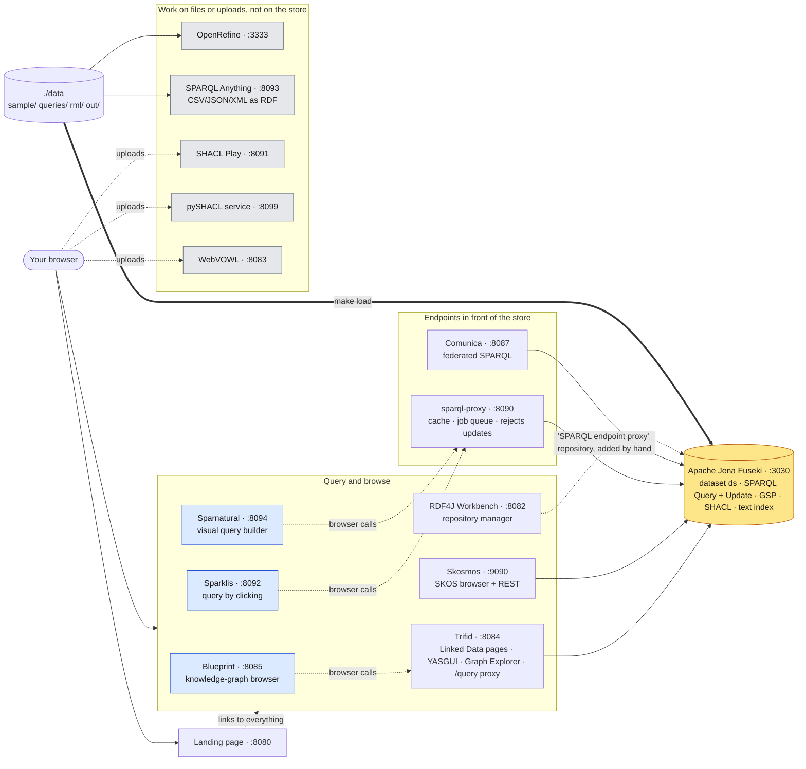
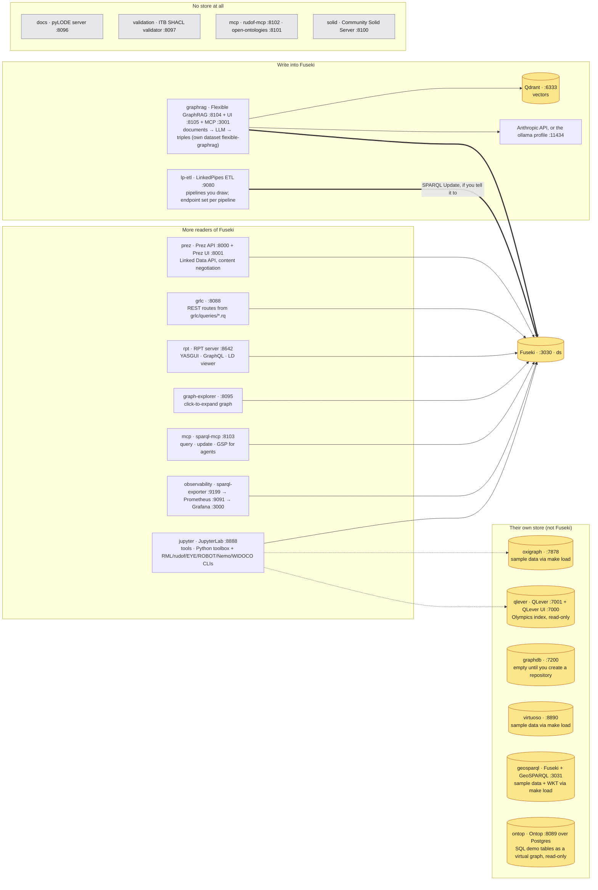
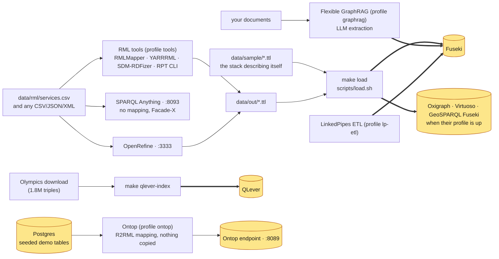

# 🏗️ Architecture

How the pieces fit, and which of them you can swap. The diagrams render on GitHub; the tables carry
the details. Every URL is the compose default; ports are the ones in [`.env.example`](../.env.example).

Three rules explain most of the wiring:

1. **Everything speaks SPARQL 1.1 over HTTP, or works on files.** No tool is tied to an engine, but
   each is *configured* for one, and that default is Fuseki.
2. **Server-side tools use container names, browser-side apps use `localhost`.** Trifid, Comunica
   or Prez run inside the Compose network and reach `http://fuseki:3030`. Blueprint, Sparklis,
   Sparnatural, QLever UI and Prez UI are JavaScript that runs in *your* browser, so they can only
   reach host ports, which is why they go through Trifid's `/query` or sparql-proxy instead of the
   store directly.
3. **Stores do not share data.** `make load` fills every writable store that is running with the
   same sample dataset; QLever serves the Olympics index and Ontop a SQL demo, so pointing a tool
   at them changes what it shows, not just where it reads.

---

## The default stack: everything around Fuseki

`make up && make load`. One store, one dataset (`ds`), every other container either reads it,
fronts it, or works on files.

Solid arrows are server-to-server calls inside the Compose network. Dotted arrows start in your
browser. Blue boxes are browser-side apps (rule 2 above); grey boxes never touch the store.

---

## Profiles: what plugs into Fuseki, what stands alone

`docker compose --profile <name> up -d`, or `make <name>-up`. Most profile services are more
readers of the same Fuseki; a few bring their own store or their own data.

The toolbox and JupyterLab know all three container URLs (`FUSEKI_URL`, `OXIGRAPH_URL`,
`QLEVER_URL`); the dotted arrows only work while those profiles are up.

---

## Alternatives: what you can point where

The store under each consumer is a setting, not a design decision. The hub in the middle is the
whole trick: every consumer takes a SPARQL endpoint URL, every store offers one.

```mermaid
flowchart LR
  subgraph consumers ["Consumers (what to change)"]
    direction TB
    c1["Trifid, and Blueprint through it<br/><code>TRIFID_SPARQL_ENDPOINT_URL</code>"]
    c2["sparql-proxy, and Sparklis + Sparnatural through it<br/><code>SPARQL_PROXY_BACKEND</code>"]
    c3["Comunica<br/><code>COMUNICA_SOURCES</code> (several at once)"]
    c4["Prez · grlc · RPT · Graph Explorer · sparql-mcp<br/><code>*_SPARQL_ENDPOINT</code>, <code>*_URL</code> in .env"]
    c5["Skosmos<br/><code>skosmos/config.ttl</code>"]
    c6["Grafana + sparql-exporter<br/><code>grafana/provisioning</code>, <code>prometheus/</code>"]
    c7["RDF4J Workbench<br/>add a repository in the UI"]
  end

  hub{{"any SPARQL 1.1 endpoint<br/>(container URL)"}}

  subgraph stores ["Stores (what you get)"]
    direction TB
    s1[("Fuseki<br/>http://fuseki:3030/ds/sparql<br/>sample data · writable")]
    s2[("Oxigraph<br/>http://oxigraph:7878/query<br/>sample data · writable")]
    s3[("Fuseki + GeoSPARQL<br/>http://fuseki-geosparql:3030/ds/sparql<br/>sample + WKT · writable")]
    s4[("Virtuoso<br/>http://virtuoso:8890/sparql<br/>sample data · writable")]
    s5[("QLever<br/>http://qlever:7001<br/>Olympics · read-only")]
    s6[("GraphDB<br/>http://graphdb:7200/repositories/ID<br/>empty · writable")]
    s7[("Ontop<br/>http://ontop:8080/sparql<br/>SQL demo · read-only")]
  end

  consumers --> hub --> stores

  classDef store fill:#fde68a,stroke:#b45309,color:#1c1917
  class s1,s2,s3,s4,s5,s6,s7 store
```

### The stores

| Store | Profile | Accepts SPARQL Update | `make load` fills it | What it holds | Mind |
|---|---|---|---|---|---|
| **Fuseki** | default | ✅ | ✅ | sample dataset in dataset `ds` | the default everything else assumes |
| **Oxigraph** | `oxigraph` | ✅ | ✅ | sample dataset | endpoint is `/query`, update is `/update`, store is `/store` |
| **Fuseki + GeoSPARQL** | `geosparql` | ✅ | ✅ | sample dataset + WKT points | a second, separate Fuseki; `geof:` functions, no admin UI |
| **Virtuoso** | `virtuoso` | ✅ (digest auth) | ✅ | sample dataset | Conductor at `/conductor`; GPL-2.0 |
| **QLever** | `qlever` | ❌ at runtime | ❌ (`make qlever-index` instead) | Olympics, 1.8M triples | different data, different IRIs; very fast reads |
| **GraphDB** | `graphdb` | ✅ | ❌ | nothing until you create a repository | restricted mode without a (free) licence; endpoint is per repository |
| **Ontop** | `ontop` | ❌ (virtual) | ❌ (it reads Postgres) | the seeded SQL demo tables | an R2RML/OBDA mapping, not a copy |

### The consumers

| Consumer | Default | How to switch | Works with | Caveats |
|---|---|---|---|---|
| **Trifid** (+ Blueprint, YASGUI, Graph Explorer) | Fuseki | `TRIFID_SPARQL_ENDPOINT_URL`, `TRIFID_DATASET_BASE_URL` | any endpoint | set the base URL to the IRIs in that store (Olympics data lives under `http://wallscope.co.uk/`) |
| **Blueprint** | Trifid's `/query` | `BLUEPRINT_FTS_DIALECT` | the store behind Trifid | full-text search dialects exist for `fuseki`, `qlever`, `graphdb` (and Stardog, Neptune); none for Oxigraph or Virtuoso. Empty until a Blueprint configuration graph is loaded, whatever the store |
| **sparql-proxy** (+ Sparklis, Sparnatural) | Fuseki | `SPARQL_PROXY_BACKEND` | any endpoint | read-only by design: updates are rejected. Sparnatural's class picker comes from `sparnatural/config.ttl`, written for the sample data |
| **Comunica** | Fuseki | `COMUNICA_SOURCES` (space-separated `sparql@URL`) | any number of endpoints | one listed source down fails the whole query, so list only profiles that are up |
| **Skosmos** | Fuseki `ds` | `skosmos/config.ttl` | any endpoint with the `Generic` dialect | `JenaText` dialect (fast search) is Fuseki-only and needs a text-indexed dataset |
| **Prez**, **grlc**, **RPT** | Fuseki | `PREZ_SPARQL_ENDPOINT`, `GRLC_SPARQL_ENDPOINT`, `RPT_SPARQL_ENDPOINT` | any endpoint | read-only consumers, no store-specific features used |
| **Graph Explorer** | Fuseki | `GRAPH_EXPLORER_CONNECTION_URL` | Fuseki, QLever, sparql-proxy, Virtuoso | its proxy only allows the origins in `PROXY_SERVER_ALLOWED_DB_ORIGINS` (`compose.yml`); add others there |
| **sparql-mcp** | Fuseki | `SPARQL_MCP_QUERY_URL`, `_UPDATE_URL`, `_GSP_URL` | any; updates need a writable store | point the query URL at sparql-proxy for a read-only agent |
| **Grafana** / **sparql-exporter** | Fuseki | `grafana/provisioning/datasources/`, `prometheus/prometheus.yml` | any endpoint | the exporter's example queries use the sample vocabulary |
| **JupyterLab**, **toolbox** | all three | `FUSEKI_URL`, `OXIGRAPH_URL`, `QLEVER_URL` already set | Fuseki, Oxigraph, QLever | notebooks pick the URL |
| **Flexible GraphRAG** | Fuseki | not switchable | Fuseki only | it creates its own dataset through Fuseki's admin API |
| **RDF4J Workbench** | none | add a "SPARQL endpoint proxy" repository | any endpoint, by container URL | the Workbench itself must be opened through the landing-page link |
| **LinkedPipes ETL** | none | per pipeline | any endpoint | each pipeline names its own source and target |
| **QLever UI** | QLever | `QLEVER_UI_BACKEND_URL` | QLever only (autocompletion uses its API) | browser-side: must be a host URL |

### Combinations that need care

- **Pointing Trifid or sparql-proxy at QLever** works for reading, but you are now browsing the
  Olympics, not the sample data: change `TRIFID_DATASET_BASE_URL`, expect Sparnatural's picker and
  Skosmos's vocabulary to come up empty, and `make load` will not have touched it.
- **Anything that writes** (sparql-mcp updates, LinkedPipes targets, Graph Store uploads) needs
  Fuseki, Oxigraph, Virtuoso, GeoSPARQL Fuseki or GraphDB. QLever, Ontop and sparql-proxy refuse.
- **GraphDB** needs a repository before any consumer can use it; the endpoint is
  `http://graphdb:7200/repositories/<id>`, and `make load` does not fill it.
- **Comunica is all-or-nothing**: a listed source that is down fails every federated query.
- **Browser-side apps need host ports.** `http://fuseki:3030` means nothing to your browser; that is
  why Blueprint, Sparklis and Sparnatural are configured with `http://localhost:8084/query` and
  `http://localhost:8090/sparql`, and why QLever UI's backend URL is `http://localhost:7001`.
  Change the host port in `.env` and those links follow; put the stack on another machine and they
  do not.
- **Two Fusekis are two stores.** The `geosparql` profile is a separate container with its own
  copy of the sample data; a GeoSPARQL query against the default Fuseki has no `geof:` functions.
- **GraphRAG writes into Fuseki, not `ds`.** Its triples live in the `flexible-graphrag` dataset,
  invisible to Trifid and friends unless you point them there.

---

## Where data comes from

Thick arrows load triples into a store; thin ones produce files. Everything that produces a file
goes through `make load` to reach a store, which keeps one path for all of it.
